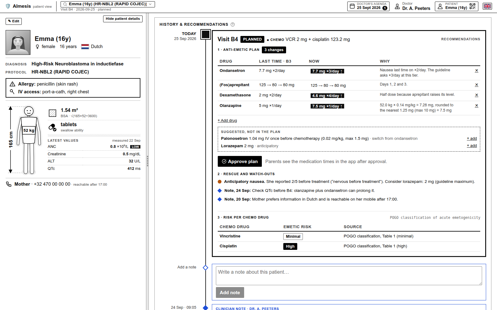
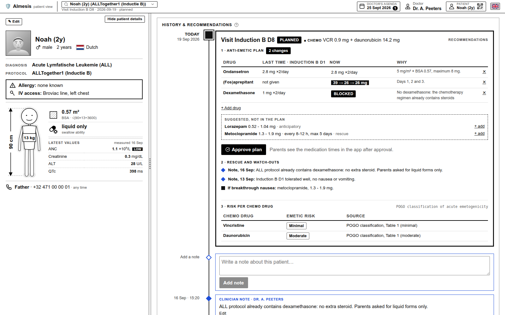
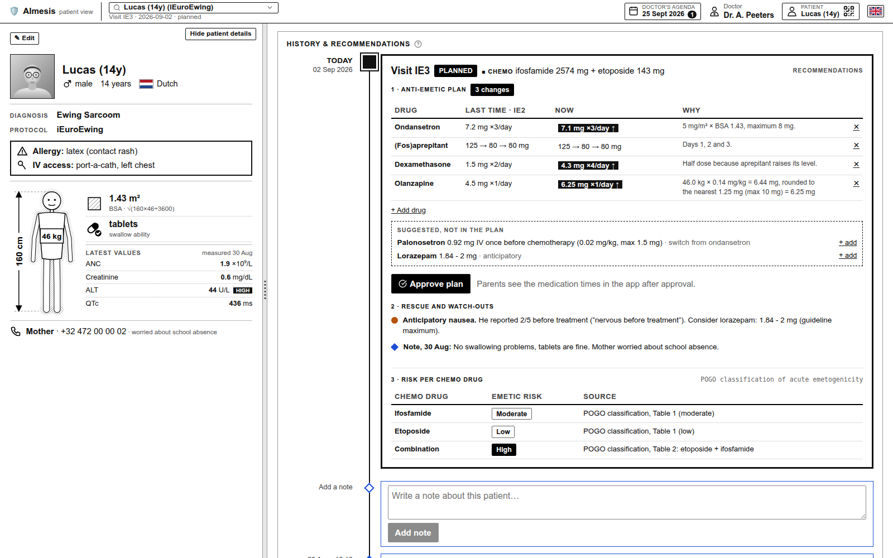
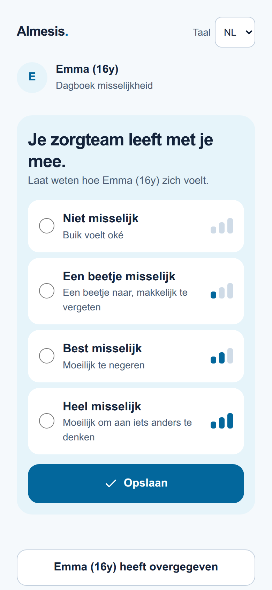
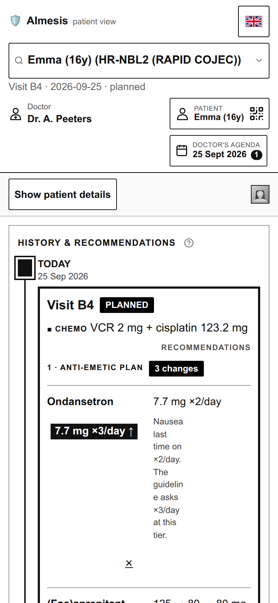

# AImesis

**Built in one day at Hack for Good 2026** (Winter Circus Ghent, Solve with Google), by a team of four working alongside several AI coding agents.

> **Safe rules decide. AI explains. Families are in the loop.**

AImesis helps pediatric oncology teams prevent chemotherapy-induced nausea and vomiting (CINV) in children, following published pediatric guidelines (POGO, CCLG), and keeps parents connected from home.



## What it does

| | |
|---|---|
| 🧮 **Rules engine, no guessing** | Rates the chemo's nausea risk (incl. dose thresholds and combinations), picks the anti-emetics and calculates every dose with the guideline's rounding and maximums. Each number shows its source. |
| 🛑 **Safety blocks** | No dexamethasone with brain tumors, mifamurtide or chemo that already contains steroids. Interaction warnings (e.g. azoles + vincristine, QTc). |
| 📈 **Learns from last cycle** | Nausea last time? The next plan steps up to the next risk level (or adds olanzapine at the highest), and says why. Parent reports from home count too. |
| 📚 **Sources on screen** | Every chemo drug shows its POGO risk level and where it comes from. |
| ✨ **Gemini handover** | Gemini turns the checked facts into a short "watch-outs" note for the doctor. Guardrails reject any dose, number or drug that isn't in the facts. |
| 👩‍⚕️ **Doctor stays in charge** | Edit and approve the plan. Nothing reaches the family before approval. |
| 📱 **Parent QR diary** | Parents scan a QR code: medication schedule in NL/FR/EN and one-tap nausea reports that flow straight back to the doctor. |

All patients, names, phone numbers and lab values in this repo are fictional demo data.

## Screenshots

**Safety block.** Noah (2y) has ALL and his chemo already contains steroids, so dexamethasone is blocked automatically:



**Combinations.** Lucas (14y) gets ifosfamide (moderate) + etoposide (low), which POGO rates as highly emetogenic together:



**On the phone.** The parent diary (left) and the clinician view on a phone (right):

<p>
  
  &nbsp;
  
</p>

## Run it

```bash
cd frontend && npm install && npm run build && cd ..
cd backend && cp .env.example .env && uv run uvicorn app.main:app --host 0.0.0.0 --port 8000
```

Open http://localhost:8000. The Gemini parts are optional (`USE_LLM=true` plus a Google Cloud project with Vertex AI); without them the app falls back to plain, rule-based text. Deploy to Cloud Run with `PROJECT=<your-project> ADMIN_KEY=<pick-one> ./deploy.sh` (see `docs/RUNNING.md`).

## Clinical sources

The rules come only from published pediatric guidelines:

- **Risk levels:** POGO, *Guideline for classification of the acute emetogenic potential of antineoplastic medication in pediatric cancer patients* ([quick summary](https://www.pogo.ca/wp-content/uploads/2014/10/POGO-Emetogenicity-Classification-Guideline-Summary-Final-rev-250111.pdf)).
- **Drugs and doses per risk level, breakthrough and anticipatory nausea:** [POGO Satellite Manual 4.3 Antiemetics](https://www.pogo.ca/satellite-manual/4-0-supportive-care-practice-tools/4-3-antiemetics/) (2022).
- **Olanzapine and metoclopramide doses, ondansetron maximum, dexamethasone contraindications:** CCLG *Guideline for the Management of CINV*, v3.1 (March 2025), Table 4.

## Team

- [Andrzej](https://github.com/nd-dew)
- [Wei Du](https://github.com/weidu-tpvision)
- [Joseph Caburnay](https://github.com/caburj)
- [Chong Wang](https://github.com/HydrionBurst)

## Stack

FastAPI + LangGraph rules engine · React + Vite · Gemini on Vertex AI · Google Cloud Run

## Disclaimer

Hackathon prototype for demonstration only. Not a medical device and not validated for clinical use.
